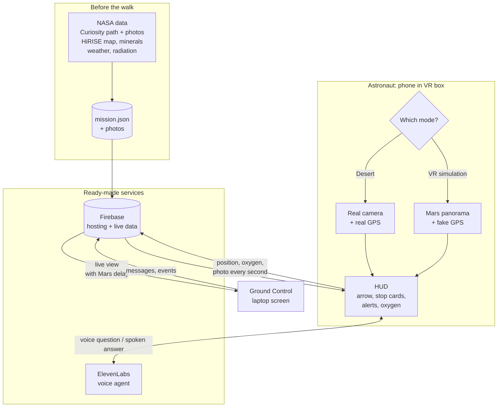
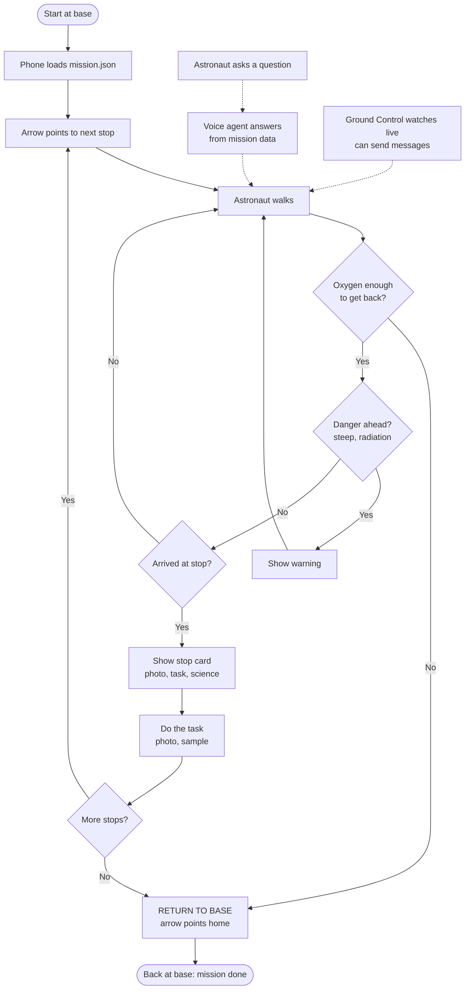
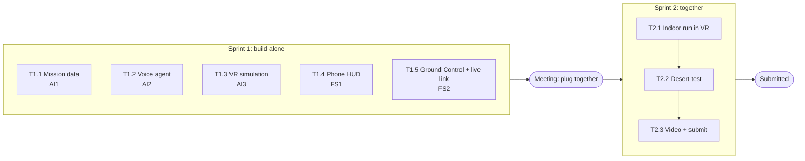

# Mars Walk HUD: System Design

## 1. What it is
A cheap helmet display for astronauts on Mars. An Android phone inside a VR box shows a **HUD** (arrow, distance, warnings, oxygen, a card at each stop) on top of either:
- the **real camera** (desert test), or
- a **Mars panorama** (VR simulation).

The mission: a **~700 m walk** through the **boxwork** area of Mount Sharp, Mars, following Curiosity's real path, with **5 science stops**. A voice assistant answers questions, and a Ground Control screen watches live.

---

## 2. The parts

| Part | What it does | Built with |
|---|---|---|
| **Mission data** | All mission info in one file: stops, route, map layers, stop cards, weather, radiation | Python script → `mission.json` + photos |
| **Phone HUD** | What the astronaut sees: two-eye view, arrow, stop cards, alerts, oxygen | HTML/JS web app |
| **VR simulation** | Mars panorama per stop; look around with your head, hold a clicker to walk along the route | JavaScript |
| **Voice agent** | Astronaut asks questions by voice, the agent answers from the mission data + live status | ElevenLabs Agents |
| **Ground Control** | Laptop screen: Mars map, live position, camera photo, readouts, messages, Mars delay | HTML/JS + Leaflet |
| **Live link + hosting** | Connects phone ↔ Ground Control; hosts the websites with HTTPS | Firebase (free) |

---

## 3. How the parts connect


---

## 4. NASA data we use

| Kind of data | Mission / instrument | Used for |
|---|---|---|
| **Optical** | MRO HiRISE (via Mars Trek) | Base map on Ground Control |
| **Topographic** | Curiosity path (height + tilt) | Route, slope warnings |
| **Spectral** | MRO CRISM | Mineral layer on the map |
| **Atmospheric** | Curiosity REMS | Temperature per stop |
| **Radiation** | Curiosity RAD | Radiation readout (~28 µSv/h) |
| **Ground photos** | Curiosity Navcam / Mastcam | Stop cards + VR panoramas |

**How data connects to a stop:** each stop has a **place** (lat/lon) for map data, and a **sol** (the Mars day Curiosity was there) for photos, weather and radiation.

### The 5 stops
| Stop | Name | Lat, Lon | Sol | Why |
|---|---|---|---|---|
| 0 | Base | -4.8036, 137.3801 | 4596 | Flat start |
| 1 | First ridges | -4.8055, 137.3795 | 4618 | First boxwork |
| 2 | Steep ridge ⚠️ | -4.8066, 137.3793 | 4639 | Steep (15°) |
| 3 | Hollow | -4.8072, 137.3799 | 4655 | Flat, possible sand |
| 4 | Main site ⭐ | -4.8080, 137.3810 | 4711 | Rover stayed ~80 sols |
| 5 | Exit | -4.8078, 137.3827 | 4820 | Then back to base |

---

## 5. Two modes

| | **Desert mode** (`field`) | **VR simulation** (`sim`) |
|---|---|---|
| Background | Phone camera | Mars panorama of the current stop |
| Position | Real GPS, converted to Mars | Fake GPS along the route |
| Moving | Walk for real | Hold the clicker |
| Looking | Real | Turn your head |
| HUD, alerts, voice, Ground Control | Same | Same |

**Desert ↔ Mars:** the desert start point = Mars base. Each step in the desert is the same step on Mars (with a rotation so the route fits the ground).

---

## 6. One Marswalk, step by step


### Safety rules (on the phone)
| Alert | When |
|---|---|
| **Slope ahead** | Next part of the route is steeper than 12° |
| **Low oxygen** | O₂ below 30 % |
| **Return to base** | O₂ time left < time to walk back + 10 min → arrow points home |
| **Message / event** | Ground Control sends a message, dust storm, solar flare or O₂ leak |

Arrival at a stop = within **20 m** for **3 seconds**. Oxygen drops **0.25 %/min**. Walking speed **0.8 m/s**.

---

## 7. Shared formats

**`mission.json`** (made once, read by everyone): `anchor` (desert ↔ Mars) · `route` (points with height + slope) · `layers` (map data, each with mission + instrument) · `stops` (position, sol, task, hazard, science, temp, radiation, photos, sources) · `suit` (oxygen + speed settings).

**Live message** (phone → Firebase, every second):
```json
{ "mode": "field", "mars": [-4.8061, 137.3795], "heading": 182, "stop": 2,
  "dist_next_m": 41, "dist_base_m": 410, "o2_pct": 82, "rad_uSv_h": 28,
  "temp_c": -60, "alerts": ["SLOPE_AHEAD"] }
```

**Voice agent ↔ HUD:** the agent calls `get_status` on the phone to get oxygen, distance and next stop before answering.

**Mars delay:** Ground Control can switch on a delay (demo 20 s, real Mars 3–22 min) to show why the astronaut needs an onboard assistant.

---

## 8. How we work

Task details are on the GitHub project board.

---

## 9. Limits and fixes

| Limit | Fix |
|---|---|
| Needs internet (Firebase, ElevenLabs) | Phone mobile data; check signal at the desert spot |
| GPS error (~5 m) | 20 m arrival circle, stops ≥ 30 m apart |
| VR box magnet breaks the compass | Remove the magnet; calibrate at start |
| Phone overheats in the sun | White vented box, shade breaks, spare phone |
| Walking blind in a VR box | Walk hand-held first; VR walk only with a spotter |
| AI makes things up | Agent answers only from mission data, else "I don't know" |
| Secrets in public code | No API keys in the repo; ElevenLabs agent limited to our domain; Firebase rules limit access |
